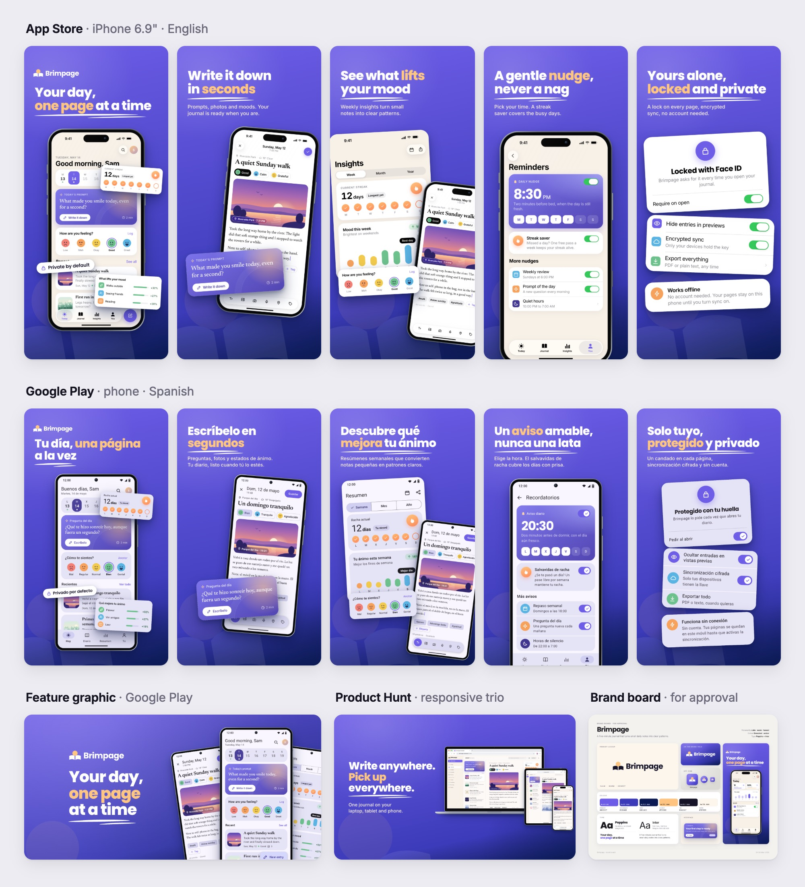
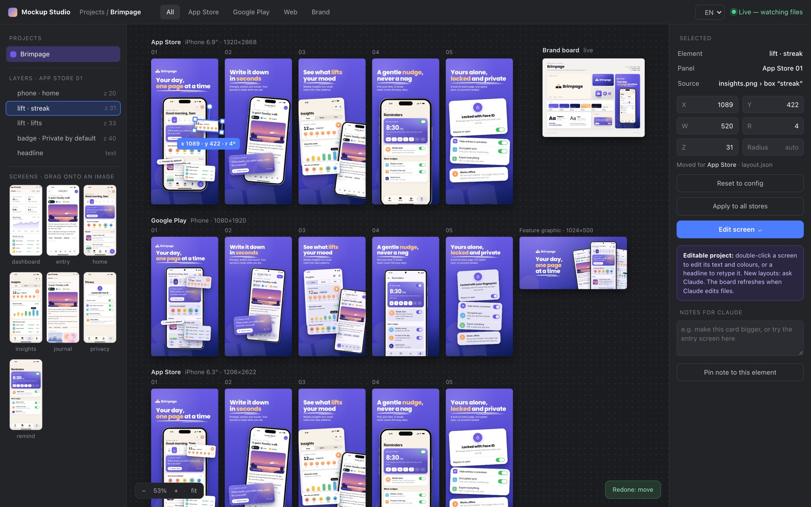
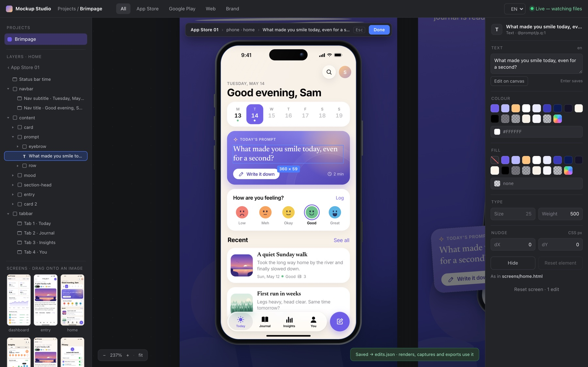

# mockup-studio

A [Claude Code](https://claude.com/claude-code) skill that makes studio-quality mockups entirely in
code: App Store and Google Play screenshot sets, device mockups, web and social images and brand boards.
Layouts are HTML and CSS, rendered by your own Chrome, so every store size and every language comes from
one design. Projects can be **editable**: the app's screens stay live, you change their text and colours
in Mockup Studio (a local, Figma-like workspace), and every store image also exports as layered SVG (for
Figma) and PDF (for print). You describe the app, or point Claude at it. Claude then:
- asks a few clickable questions (what, which stores, languages, how many images, brand, look, tone, and
  editable or screenshots);
- sets the brand first: palette options with contrast checks, font pairs, logo directions, the app
  icon, and one brand board for your approval;
- gets the screens: it captures your real app from the iOS Simulator, an Android emulator or a live URL,
  or, if the app is not built yet, designs the screens itself with a mock-screen kit;
- writes the story and the headlines, lays out each image from proven recipes, and renders every store
  size and language;
- looks at every image, fixes what it sees, and validates every file against the current store rules.

It also makes images for websites and web apps: browser, laptop and responsive device mockups, Open Graph
and social images, Product Hunt, Chrome Web Store and Mac App Store images, landing heroes and portfolio
covers. The method comes from a real client project; every mistake made there is written down, so the
next set doesn't repeat it.

<p align="center">
  
</p>
<p align="center"><sub>Brimpage, an invented demo app built from a description as an editable project: every pixel above is HTML and CSS, and every store image (and the feature graphic) also exists as layered SVG.</sub></p>

## Two kinds of project
| | editable | screenshots |
|---|---|---|
| made from | mock screens Claude designs with the kit (an app or a site that is not built yet) | real captures: Simulator, emulator, device, your screenshots, a live URL |
| screens in the images | drawn live from their HTML: sharp at any size | PNG captures in device frames |
| you can change | positions, headlines, AND the text and colours inside every screen, in Mockup Studio | positions and headlines, in Mockup Studio |
| also exports | layered SVG (named layers, real text, fonts embedded: drag it into Figma) and PDF | the same files, each screen kept as one picture |

Claude asks which one at the start: editable is the recommendation for mock screens, and real captures
are always screenshots. One project can hold both (real app captures plus designed web pages).

## What you get
- **Upload-ready images** at the exact store sizes, 24-bit RGB with no transparency, in
  `final/<language>/<store>/01.png ...`:
  - App Store: iPhone 6.3" (the size App Store Connect now requires) and 6.9", iPad 13" if needed;
  - Google Play: the phone set (1080x1920, or 2160x3840), the 1024x500 feature graphic;
  - the store icons of the stores in the set (1024 RGB for Apple, 512 RGBA for Play);
  - web targets: Open Graph, X, LinkedIn, Instagram, Product Hunt, Chrome Web Store, Mac App Store,
    landing-page heroes, a 4:3 portfolio cover.
- **Overview sheets** up to 3840 px wide to present a set, and **hi-res copies** (2x or 3x) for Behance,
  Dribbble or Upwork, kept apart from the upload files.
- **Editable files** on request: every store image and the feature graphic as SVG for Figma and PDF for
  Illustrator, Affinity or print, in `final/vector/` (the brand board, icons and sheets stay PNG and JPEG).
  What Figma keeps and what it may drop is listed honestly in `references/editable.md`: import one SVG
  yourself before you promise Figma files to a client.
- **A brand board** (logo, icon, palette with contrast scores, type pair, a UI card, a store-image
  preview) and the logo as transparent PNGs.
- **A validation report**: sizes, formats, alpha, file limits, image counts, soft (upscaled) screens,
  store content rules (no "#1", prices, calls to action or other stores' names), and the vector files.

## Mockup Studio
A local workspace that shows every image of every project live on one canvas. Drag, rotate and resize
elements, drop a screen onto an image, retype a headline in place, or pin a note for Claude; every render
then matches what you see.

<p align="center">
  
</p>

In an editable project, double-click a phone (or a tablet, a browser, a lifted card) to enter its screen:
pick a layer, type new words in place, recolour with the brand's own colours, change the size, nudge or
hide it. Every image that shows that screen updates at once, with undo and redo.

<p align="center">
  
</p>

```bash
cd ~/.claude/skills/mockup-studio/workspace && npm install && npm start -- ~/store-projects/my-app
```

## What is in the skill
- **`SKILL.md`**: the intake questions, the pipeline in order (brand, screens, copy, layout, render,
  look and fix, validate, deliver), the 20 rules that matter most, output folders, and how to keep a
  laptop responsive while rendering.
- **`references/`**: guides Claude reads as each step comes up:
  - `intake.md`: the exact question set, defaults, and where each answer goes;
  - `brand.md`: the palette method and contrast checks, font pairs by personality, logo and icon recipes;
  - `capture.md`: Simulator and emulator commands, clean status bars, demo data (real captures);
  - `mock-screens.md`: the mock-screen kit and iOS vs Android conventions (mock screens);
  - `editable.md`: live screens, `edits.json`, SVG and PDF export, Figma import and its limits;
  - `web.md`: web targets, capture from a URL, the web kit, wide layouts, the responsive trio;
  - `design.md`: the story of a set, copy rules, consistency, localization, right to left, sharpness;
  - `layouts.md`: proven layout recipes with sketches and copy-paste configs;
  - `store-specs.md` and `policy.md`: every size, format and limit, and what the stores allow on images;
  - `workspace.md`: Mockup Studio; `client-brief.md`: running a paid job; `lessons.md`.
- **`assets/template/`**: the starter project. One config file (`studio.config.js`), the layout engine,
  CSS device frames (iPhone, Android, iPad, browser, laptop, monitor), the brand tools, the mock-screen
  kit for iOS, Android and the web, URL capture, render, vector export, validate and overview-sheet
  scripts, and the Brimpage demo (an invented name, checked as unused in both stores; its site is
  `brimpage.example`).
- **`workspace/`**: Mockup Studio, the local app to preview every image live, move things and edit
  screens by hand.
- **`tests/`**: the repo's checks (`node tests/all.js`, after `npm install` in `assets/template`): live
  screens match captures, edits, the SVG and PDF files, the rename (it lists files with git in a clone, and
  walks the folder in a ZIP download).

## Install
```bash
git clone https://github.com/Marwanenoudouar10/mockup-studio ~/.claude/skills/mockup-studio
```
Claude Code picks up the skill automatically. Each project is created in its own folder, copied from the
template, never inside the skill.

**Renamed from `store-screenshots`.** An older install lives in `~/.claude/skills/store-screenshots`: move it
with `mv ~/.claude/skills/store-screenshots ~/.claude/skills/mockup-studio` and `git pull` there (GitHub
redirects the old URL). Store Studio is now Mockup Studio: it copies its project list from
`~/.config/store-studio/` on its first start. Projects made from the old template keep working; their
`CLAUDE.md` still says "Store Studio", which is the same app.

## Quick start
Open Claude Code anywhere and ask. One prompt per way in:

**From screenshots** (the app exists):
> make App Store and Google Play screenshots for my app in ~/code/acme-app, English and German

Claude asks what it still needs, confirms the brand from your app, boots the Simulator and an emulator
with a clean status bar (or uses the screenshots you drop in), and builds the set.

**From a description** (no build yet):
> I have an idea for a habit tracker for students. Design the brand and make editable App Store
> mockups I can tweak in Figma, for a portfolio piece

Claude shows palettes, font pairs and logo directions to choose from, a brand board to approve, then
designs the app's key screens and makes the set, with an SVG and a PDF of every store image.

**A website or web app:**
> make an Open Graph image and a Product Hunt gallery for https://example.com

Other things to try:
- "localize my store screenshots into Arabic and Spanish"
- "a Google Play feature graphic for my app"
- "turn these 5 screenshots into a professional App Store set" (with the files attached or in a folder)
- "browser and laptop mockups of my dashboard for the landing page"
- "a responsive mockup (laptop, tablet, phone) of my site for my Upwork portfolio"
- "my store images look amateur: redo them in a dark, premium style"
- "open the project in Mockup Studio so I can fix the texts myself"

## What you need
- **Node.js 18 or newer** (with npm).
- **Google Chrome**, Chromium or Microsoft Edge, installed normally. The skill finds it on macOS, Linux
  and Windows; set `CHROME_PATH` if it lives somewhere else. No extra browser download.
- **For real captures on a Mac:** Xcode with the iOS Simulator, and Android Studio with an emulator
  (`adb`), or screenshots from a device.
- Nothing else: fonts come from npm (open-licensed fontsource packages), and no image tools are needed.
  `--outline-text` (SVG text as shapes) uses `fontkit`, an optional dependency `npm install` adds.
- `npm install` reports high-severity advisories in `puppeteer-core` 24 (`extract-zip`, `basic-ftp`,
  `proxy-agent`, `zod`, through `@puppeteer/browsers` and `chromium-bidi`). They sit in the browser
  download, unzip and proxy code and in the WebDriver BiDi layer; the skill uses none of them: it
  launches your installed Chrome over the DevTools protocol on 127.0.0.1 and downloads nothing. The
  clean releases (puppeteer-core 25.13+) need Node 22.12+; on such a Node, `npm i puppeteer-core@25` in
  a project gives a clean `npm audit`.
- A laptop is enough. Renders run one at a time in one browser; the demo's full export takes about 40
  seconds, about a minute with the SVG and PDF files.

Store rules were checked on 2026-10-24 (`references/store-specs.md` lists the sources). They change:
check them at the start of each client job.

## License
[MIT](LICENSE) © 2026 Marwane Boudouar
